<picture><source media="(prefers-color-scheme: dark)" srcset="assets/v1/en/hero-dark.svg"></picture>

  <a href="README.pt-BR.md"><b>Português</b></a>

<picture><source media="(prefers-color-scheme: dark)" srcset="assets/v1/en/rule-dark.svg"></picture>

I build web applications and Windows tools, exploring reverse engineering, drivers, and low-level security.

This is where I share projects involving software development, reverse engineering, and security. Some explore how binaries work, while others dig deeper into Windows, down to drivers and the kernel.

 

  <picture><source media="(prefers-color-scheme: dark)" srcset="assets/v1/en/pil-web-dark.svg">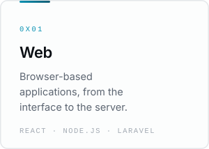</picture>
  <picture><source media="(prefers-color-scheme: dark)" srcset="assets/v1/en/pil-reverse-dark.svg">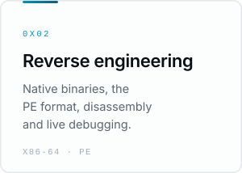</picture>
  <picture><source media="(prefers-color-scheme: dark)" srcset="assets/v1/en/pil-windows-dark.svg">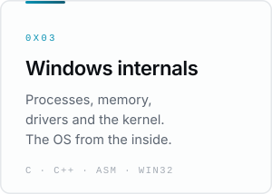</picture>
  <picture><source media="(prefers-color-scheme: dark)" srcset="assets/v1/en/pil-security-dark.svg">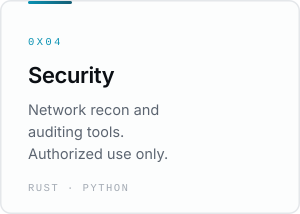</picture>

<picture><source media="(prefers-color-scheme: dark)" srcset="assets/v1/en/metrics-dark.svg">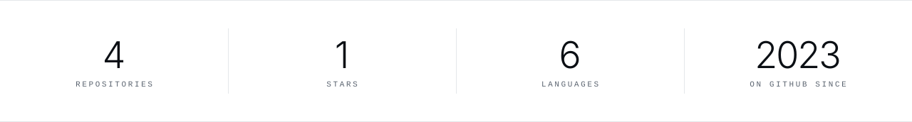</picture>

<picture><source media="(prefers-color-scheme: dark)" srcset="assets/v1/en/h-featured-dark.svg">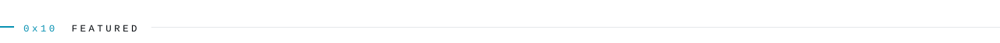</picture>

  <a href="https://github.com/Erickware/Injector"><picture><source media="(prefers-color-scheme: dark)" srcset="assets/v1/en/feat-injector-dark.svg">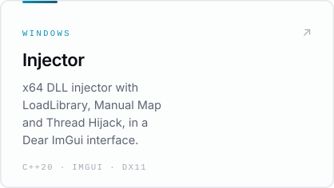</picture></a>
  <a href="https://github.com/Erickware/inertia"><picture><source media="(prefers-color-scheme: dark)" srcset="assets/v1/en/feat-inertia-dark.svg">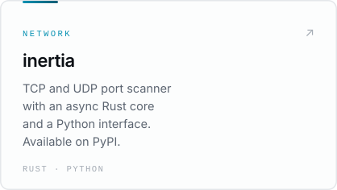</picture></a>
  <a href="https://github.com/Erickware/Kernel-Driver-Bypass"><picture><source media="(prefers-color-scheme: dark)" srcset="assets/v1/en/feat-kernel-dark.svg">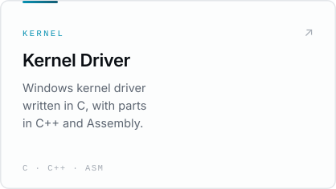</picture></a>

<picture><source media="(prefers-color-scheme: dark)" srcset="assets/v1/en/h-oss-dark.svg">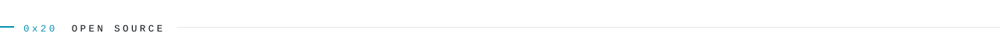</picture>

<!-- OSS:START -->
| Repository | What it is | Stack | Updated |
|:--|:--|:--|:--|
| **[Injector](https://github.com/Erickware/Injector)** | x64 DLL injector for Windows with LoadLibrary, Manual Map and Thread Hijack. Dear ImGui interface on DirectX 11. | `C++20` `Dear ImGui` `DirectX 11` | 26 Oct 2026 |
| **[Kernel-Driver-Bypass](https://github.com/Erickware/Kernel-Driver-Bypass)** | Windows kernel driver written in C, with parts in C++ and Assembly. | `C` `C++` `Assembly` | 24 Oct 2026 |
| **[fix-wsl-docker](https://github.com/Erickware/fix-wsl-docker)** | PowerShell script that fixes the WSL and Docker integration on Windows. | `PowerShell` `WSL` `Docker` | 05 Oct 2026 |
| **[inertia](https://github.com/Erickware/inertia)** · 1 ★ | TCP and UDP port scanner: async Rust core, Python interface, per-target timeout calibration. Available on PyPI. | `Rust` `Python` `PyPI` | 08 May 2026 |

Synced 26 Oct 2026 · public repositories only
<!-- OSS:END -->

<a href="https://github.com/Erickware?tab=repositories"><b>All repositories →</b></a>

<picture><source media="(prefers-color-scheme: dark)" srcset="assets/v1/en/h-stack-dark.svg"></picture>

  <code>TypeScript</code> <code>JavaScript</code> <code>Python</code> <code>C#</code> <code>C++</code> <code>SQL</code> <code>PHP</code> 
  <code>Laravel</code> <code>React</code> <code>Node.js</code> <code>PostgreSQL</code> 
  <code>Linux</code> <code>nginx</code> <code>systemd</code> <code>GitHub Actions</code> <code>Playwright</code>

<picture><source media="(prefers-color-scheme: dark)" srcset="assets/v1/en/rule-dark.svg"></picture>

  <a href="https://github.com/Erickware">GitHub</a>
  &nbsp;·&nbsp;
  <a href="https://github.com/Erickware?tab=repositories">Repositories</a>
  &nbsp;·&nbsp;
  <a href="https://github.com/Erickware?tab=stars">Stars</a>

