<picture><source media="(prefers-color-scheme: dark)" srcset="assets/v1/pt/hero-dark.svg"></picture>

  <a href="README.md"><b>English</b></a>

<picture><source media="(prefers-color-scheme: dark)" srcset="assets/v1/pt/rule-dark.svg"></picture>

Desenvolvo aplicações web e ferramentas para Windows, explorando engenharia reversa, drivers e segurança de baixo nível.

Aqui compartilho projetos de desenvolvimento de software, engenharia reversa e segurança. Alguns exploram como os binários funcionam; outros vão mais fundo no Windows, até os drivers e o kernel.

 

  <picture><source media="(prefers-color-scheme: dark)" srcset="assets/v1/pt/pil-web-dark.svg">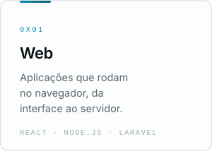</picture>
  <picture><source media="(prefers-color-scheme: dark)" srcset="assets/v1/pt/pil-reverse-dark.svg">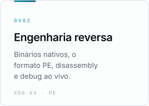</picture>
  <picture><source media="(prefers-color-scheme: dark)" srcset="assets/v1/pt/pil-windows-dark.svg">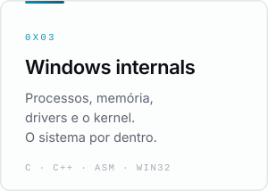</picture>
  <picture><source media="(prefers-color-scheme: dark)" srcset="assets/v1/pt/pil-security-dark.svg">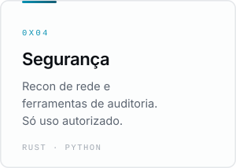</picture>

<picture><source media="(prefers-color-scheme: dark)" srcset="assets/v1/pt/metrics-dark.svg">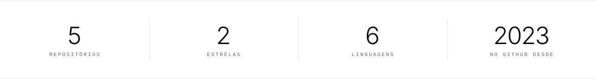</picture>

<picture><source media="(prefers-color-scheme: dark)" srcset="assets/v1/pt/h-featured-dark.svg">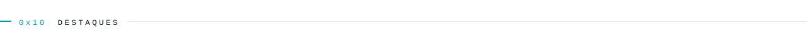</picture>

  <a href="https://github.com/Erickware/Injector"><picture><source media="(prefers-color-scheme: dark)" srcset="assets/v1/pt/feat-injector-dark.svg">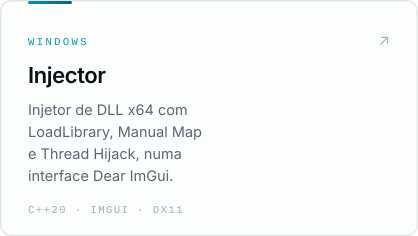</picture></a>
  <a href="https://github.com/Erickware/inertia"><picture><source media="(prefers-color-scheme: dark)" srcset="assets/v1/pt/feat-inertia-dark.svg">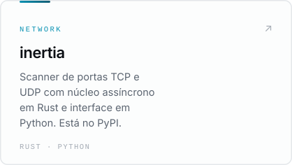</picture></a>
  <a href="https://github.com/Erickware/Kernel-Driver-Bypass"><picture><source media="(prefers-color-scheme: dark)" srcset="assets/v1/pt/feat-kernel-dark.svg">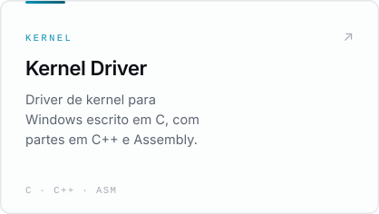</picture></a>

<picture><source media="(prefers-color-scheme: dark)" srcset="assets/v1/pt/h-oss-dark.svg">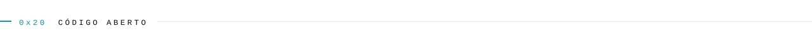</picture>

<!-- OSS:START -->
| Repositório | O que é | Stack | Atualizado |
|:--|:--|:--|:--|
| **[AetherHV](https://github.com/Erickware/AetherHV)** | Stealth-focused Intel VT-x hypervisor (EAC/BE/ACs/AVs). | `C` | 28 out 2026 |
| **[Injector](https://github.com/Erickware/Injector)** | Injetor de DLL para Windows x64 com LoadLibrary, Manual Map e Thread Hijack. Interface em Dear ImGui sobre DirectX 11. | `C++20` `Dear ImGui` `DirectX 11` | 28 out 2026 |
| **[Kernel-Driver-Bypass](https://github.com/Erickware/Kernel-Driver-Bypass)** · 1 ★ | Driver de kernel para Windows escrito em C, com partes em C++ e Assembly. | `C` `C++` `Assembly` | 25 out 2026 |
| **[fix-wsl-docker](https://github.com/Erickware/fix-wsl-docker)** | Script PowerShell que conserta a integração entre WSL e Docker no Windows. | `PowerShell` `WSL` `Docker` | 05 out 2026 |
| **[inertia](https://github.com/Erickware/inertia)** · 1 ★ | Scanner de portas TCP e UDP: núcleo assíncrono em Rust, interface em Python, timeouts calibrados por alvo. Disponível no PyPI. | `Rust` `Python` `PyPI` | 08 mai 2026 |

Atualizado em 31 out 2026 · apenas repositórios públicos
<!-- OSS:END -->

<a href="https://github.com/Erickware?tab=repositories"><b>Todos os repositórios →</b></a>

<picture><source media="(prefers-color-scheme: dark)" srcset="assets/v1/pt/h-stack-dark.svg">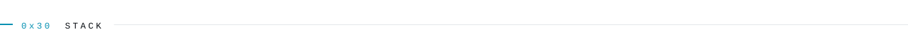</picture>

  <code>TypeScript</code> <code>JavaScript</code> <code>Python</code> <code>SQL</code> <code>PHP</code> 
  <code>Laravel</code> <code>React</code> <code>Node.js</code> <code>PostgreSQL</code> 
  <code>Linux</code> <code>nginx</code> <code>systemd</code> <code>GitHub Actions</code> <code>Playwright</code>

<picture><source media="(prefers-color-scheme: dark)" srcset="assets/v1/pt/rule-dark.svg"></picture>

  <a href="https://github.com/Erickware">GitHub</a>
  &nbsp;·&nbsp;
  <a href="https://github.com/Erickware?tab=repositories">Repositórios</a>
  &nbsp;·&nbsp;
  <a href="https://github.com/Erickware?tab=stars">Estrelas</a>

